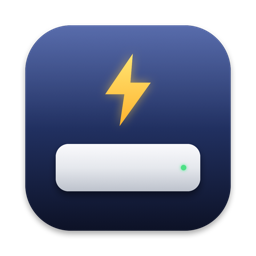
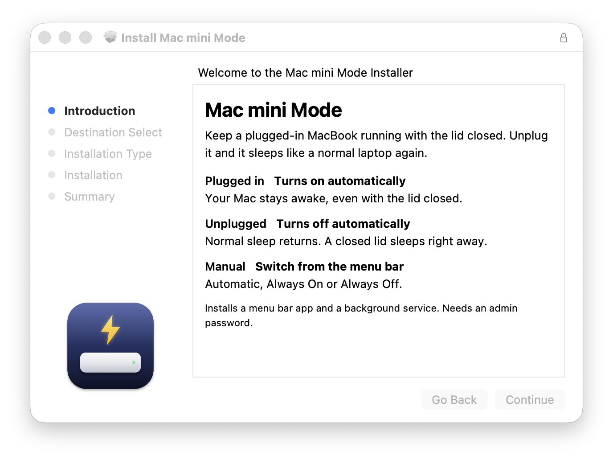

<p align="center">
  
</p>

<h1 align="center">Mac mini Mode</h1>

<p align="center">Keep a plugged-in MacBook running with the lid closed. Unplug it and it sleeps like a normal laptop again.</p>

<p align="center">
  <a href="https://github.com/Pama-Lee/MacMiniMode/releases/latest/download/MacMiniMode.pkg"></a>
  &nbsp;
  <a href="https://github.com/Pama-Lee/MacMiniMode/releases/latest/download/MacMiniMode.pkg"></a>
</p>

<p align="center"><b>English</b> · <a href="README.zh-CN.md">简体中文（安装说明）</a></p>

## Install

1. Click **Download for macOS** above to get `MacMiniMode.pkg`.
2. Double-click it and follow the installer. You will be asked for your Mac password once.
3. A new icon appears in the menu bar. It is already working, no restart needed.

The installer is signed and notarized by Apple, so macOS opens it without warnings. Requires macOS 12 or later, on Apple silicon or Intel.

<p align="center">
  
</p>

## What it does

Mac mini Mode turns a MacBook into an always-on home server or headless Mac. It gives you clamshell mode without an external display or a dummy HDMI plug, and there is no `caffeinate` or `sudo pmset disablesleep` to remember. Because it follows the power adapter, your MacBook never stays awake inside your bag.

- **On when plugged in**: sleep is disabled on AC power, so your Mac keeps running with the lid closed and no display attached.
- **Off when unplugged**: normal sleep returns on battery. If the lid is already closed, the Mac sleeps right away.
- **Menu bar control**: switch between Automatic, Always On and Always Off, and see the current state at a glance.
- **Quit and Allow Sleep**: choosing Quit switches to Always Off and waits until sleep is allowed. The setting stays off after reconnecting power or restarting; choose Automatic or Always On to enable it again. Logging out, restarting or shutting down macOS preserves the selected mode. Other power settings are unchanged.
- **Screen off with the lid closed**: the built-in display's backlight turns off when you close the lid and returns to its previous brightness when you open it. Only the backlight changes, so the Mac does not lock and remote desktop or running apps are not interrupted. It never touches an external display. Can be switched off in the menu.
- **Health Check**: one click checks whether Remote Login, Screen Sharing, the battery and power settings are ready, and copies diagnostics for bug reports.
- **Low-battery protection**: in Always On on battery, sleep is allowed again at 10%. Open **Settings…** to switch to Automatic at a chosen battery level instead. Choose a threshold from 10% to 50%, and whether to stay in Automatic or restore Always On after charging.
- **Agent tasks**: Codex and Claude Code can keep the Mac running during long jobs through MCP. Tasks share the selected mode; finishing the last task switches to Always Off. View and end tasks from the menu. See [plugin setup](docs/AGENT-CONTROL.md). Requires macOS 13 or later.
- **Command line**: `macminimode status` and `macminimode on|off|auto`, also usable from Shortcuts with Run Shell Script.

## Codex plugin

Requires macOS 13 or later, Codex with plugin support, and a version of Mac mini Mode that includes agent tasks installed in `/Applications`.

Use `macminimode-codex-plugin.zip`. To build the ZIP from this source checkout, install the Xcode command-line tools and run `bash scripts/package-plugins.sh`; the archive is written to `build/`.

### Let Codex install it

Attach the plugin ZIP to a local Codex chat and send:

> Install this MacMiniMode plugin for my local Codex user. Extract it into a permanent folder under my Codex home, add its local marketplace, and install macminimode@macminimode-local. Preserve my existing configuration. Check that get_status is available and report the current mode. Ask me to restart Codex if the tools need to reload.

Restart Codex if requested, then open a new chat and ask it to check MacMiniMode's status.

### Install manually

With the ZIP in Downloads, run:

```sh
mkdir -p "$HOME/.codex/local-marketplaces/macminimode"
ditto -x -k "$HOME/Downloads/macminimode-codex-plugin.zip" "$HOME/.codex/local-marketplaces/macminimode"
codex plugin marketplace add "$HOME/.codex/local-marketplaces/macminimode/codex"
codex plugin add macminimode@macminimode-local
```

Keep the extracted folder in place. Restart Codex, select MacMiniMode in a new chat, and ask it to check the current status. If you use a custom `CODEX_HOME`, use that directory in place of `$HOME/.codex`.

### Use automatically on this Mac (optional)

To use the plugin for long tasks across projects, append the following to your user-level `~/.codex/AGENTS.md` (or `$CODEX_HOME/AGENTS.md`). Keep your existing instructions. Codex reads this file when starting a session; see [Codex custom instructions](https://learn.chatgpt.com/docs/agent-configuration/agents-md).

```markdown
## MacMiniMode

For long local builds, tests and batch jobs on this Mac, use the installed
MacMiniMode skill. Check get_status, then begin_task with a fresh UUID and
mode auto. Retain the task ID until the work and its background processes
finish; call end_task on completion, failure or cancellation, and before
waiting for my input when no background work remains. Ordinary conversation
and short commands need no task. Use on only when I explicitly request
continued operation on battery. Respect manual mode changes and low-battery
protection. If tools are unavailable, tell me. Use set_mode only when I
explicitly ask to change the mode.
```

You can also ask Codex to append this block for you. It applies to your Codex user on this Mac; use a project's `AGENTS.md` to limit it to that project. Remove the block to return to choosing when to use the plugin yourself.

Automatic keeps the Mac awake while plugged in. Ending the last task selects Always Off. Tasks left by a closed or disconnected client can be ended from **Agent Tasks** in the menu.

See [plugin setup](docs/AGENT-CONTROL.md) for Claude Code, other MCP clients and uninstall commands.

## Updates

Once a day the app asks GitHub whether a newer version exists. If so it downloads the installer, verifies its signature, and asks before installing; Install opens the system installer. To turn this off, uncheck **Check for Updates Automatically** in the menu and use **Check for Updates…** when you want.

## Troubleshooting

Update to the latest version first. If your Mac still sleeps with the lid closed, choose **Health Check…** from the menu bar icon, click **Copy Diagnostics**, and paste it in [Issues](../../issues). A common cause is remote desktop or cleaner software that rewrites power settings on a timer; the app now restores the setting right away and notes it in the log.

If the screen is still dark after you open the lid (rare, for example if the app was force-quit while the lid was closed), press the brightness-up key (F2). Over a remote connection you can also run `macminimode screen-on`.

## Uninstall

```bash
sudo /Applications/MacMiniMode.app/Contents/Resources/uninstall.sh
```

## License

[MIT](LICENSE)
