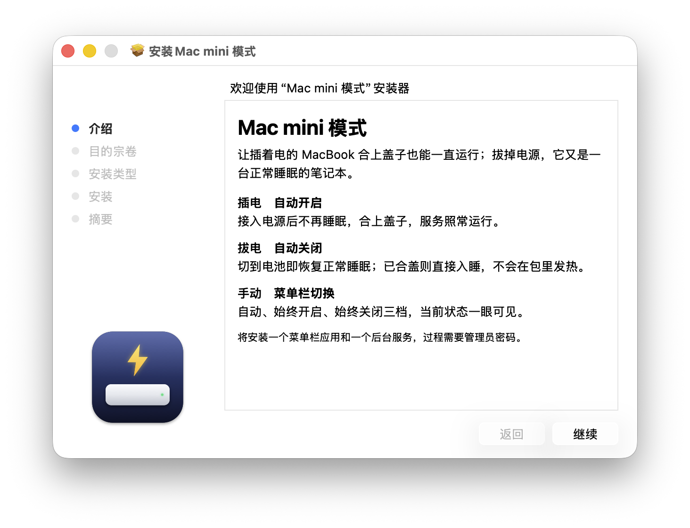

<p align="center">
  
</p>

<h1 align="center">Mac mini 模式</h1>

<p align="center">让插着电的 MacBook 合上盖子也能一直运行；拔掉电源，它又是一台正常睡眠的笔记本。</p>

<p align="center">
  <a href="https://github.com/Pama-Lee/MacMiniMode/releases/latest/download/MacMiniMode.pkg"></a>
</p>

<p align="center"><a href="README.md">English</a> · <b>简体中文</b></p>

## 安装

1. 点上面的「下载安装包」，会得到一个 `MacMiniMode.pkg`。
2. 双击打开，一路点「继续」，中途输入一次开机密码。
3. 装完菜单栏会多出一个图标，这时已经在工作了，不用重启。

安装包已签名并通过 Apple 公证，打开时不会提示「无法验证开发者」。支持 macOS 12 及以上，Apple 芯片和 Intel 均可。

<p align="center">
  
</p>

## 它做什么

把 MacBook 放在家里当 Mac mini、家用服务器或无头主机用：合盖不休眠，不需要外接显示器或 HDMI 假负载，也不用记着敲 `caffeinate` 或 `sudo pmset disablesleep`。它跟随电源适配器自动开关，所以 MacBook 不会在包里一直醒着。

- **插电自动开启**：接入电源后不再睡眠，合盖、不接显示器也照常运行。
- **拔电自动关闭**：切到电池立即恢复正常睡眠；已合盖则直接入睡。
- **菜单栏切换**：自动、始终开启、始终关闭三档，当前状态一眼可见。
- **退出并恢复睡眠**：主动退出时切换到「始终关闭」，确认已允许睡眠后再退出。再次插电或重启也不会自动开启，需重新选择「自动」或「始终开启」。系统注销、重启或关机保留所选模式。其他电源设置不变。
- **合盖熄屏**：合上盖子后自动关掉屏幕背光，开盖恢复原来的亮度。只关背光，不会锁屏，也不会打断远程桌面或正在运行的应用。接着外接显示器时不会动它。可在菜单里关闭。
- **体检**：一键检查远程登录、屏幕共享、电池和电源设置是否就绪，并可复制诊断信息用于反馈。
- **低电量保护**：「始终开启」时用电池，电量降到 10% 会自动放行睡眠。也可以在「设置…」里开启低电量切换，在 10%–50% 之间选择电量，达到后切到「自动」；充电后保持自动还是恢复始终开启，也可以自己选。
- **Agent 任务**：Codex 和 Claude Code 可以通过 MCP 在长任务期间保持 Mac 运行。多个任务共用模式，最后一个任务结束后切到「始终关闭」。菜单里可以查看和结束任务，安装方法见[插件设置](docs/AGENT-CONTROL.zh-CN.md)。需要 macOS 13 及以上。
- **命令行**：`macminimode status`、`macminimode on|off|auto`，也可以在快捷指令里用「运行 Shell 脚本」调用。

## Codex 插件

需要 macOS 13 及以上、支持插件的 Codex，以及安装在 `/Applications` 中、带 Agent 任务功能的 Mac mini 模式。

准备好 `macminimode-codex-plugin.zip`。如需从当前源码构建，先安装 Xcode 命令行工具，再运行 `bash scripts/package-plugins.sh`，压缩包会生成在 `build/` 目录。

### 让 Codex 自动安装

在本机 Codex 聊天中附上插件 ZIP，发送：

> 请为我的本机 Codex 用户安装这个 MacMiniMode 插件。把它解压到 Codex 用户目录下的固定文件夹，添加本地 marketplace，并安装 macminimode@macminimode-local。保留已有配置，检查 get_status 是否可用，并告诉我当前模式。如果需要重新加载工具，请提示我重启 Codex。

按提示重启后，打开新聊天，让 Codex 检查 MacMiniMode 当前状态。

### 手动安装

把 ZIP 放在「下载」目录，然后运行：

```sh
mkdir -p "$HOME/.codex/local-marketplaces/macminimode"
ditto -x -k "$HOME/Downloads/macminimode-codex-plugin.zip" "$HOME/.codex/local-marketplaces/macminimode"
codex plugin marketplace add "$HOME/.codex/local-marketplaces/macminimode/codex"
codex plugin add macminimode@macminimode-local
```

保留解压后的文件夹。重启 Codex，在新聊天中选择 MacMiniMode，让它检查当前状态。如果设置了自定义 `CODEX_HOME`，把命令中的 `$HOME/.codex` 换成对应目录。

### 在这台 Mac 上自动使用（可选）

如果希望 Codex 在各个项目的长任务中自动使用插件，把下面这段追加到用户级 `~/.codex/AGENTS.md`；设置了 `CODEX_HOME` 时则使用 `$CODEX_HOME/AGENTS.md`。保留文件中已有的指令。Codex 在新会话中读取这个文件，详见 [Codex 自定义指令](https://learn.chatgpt.com/docs/agent-configuration/agents-md)。

```markdown
## MacMiniMode

在这台 Mac 上执行耗时较长的本机构建、测试和批处理前，使用已安装的
MacMiniMode 技能。先查询 get_status，再用新 UUID 和 auto 模式调用
begin_task。保留任务 ID，直到工作及其后台进程结束；完成、失败或取消后
调用 end_task，没有后台工作而需要等待我回复时也结束任务。
普通对话和短命令无需登记。只有我明确要求电池供电时继续运行，才使用 on。
尊重手动切换的模式和低电量保护。工具不可用时告诉我。
只有我明确要求切换模式时，才使用 set_mode。
```

也可以让 Codex 帮你追加这段内容。它对这台 Mac 上当前 Codex 用户的各个项目生效；只想在一个项目中使用，就放到那个项目的 `AGENTS.md`。移除这段指令后，恢复为按需选择插件。

自动模式在插电时保持运行，最后一个任务结束后切到「始终关闭」。客户端退出或断线留下的任务，可以从菜单里的「Agent 任务」结束。

Claude Code、其他 MCP 客户端和卸载方法见[插件设置](docs/AGENT-CONTROL.zh-CN.md)。

## 更新

应用每天会向 GitHub 查一次有没有新版本。有的话会自动下载、校验签名，然后弹窗问你要不要安装；点「安装」会打开系统安装器。不想自动检查，可以在菜单里取消勾选「自动检查更新」，需要时再点「检查更新…」。

## 遇到问题

先升级到最新版。如果合盖后还是会睡，点菜单栏图标里的「体检…」，再点「复制诊断信息」，把内容贴到 [Issues](../../issues)。常见原因是远程桌面或清理类软件会定时改电源设置，新版会自动改回去，并在日志里记一笔。

开盖后屏幕如果还是黑的（极少见，比如合盖期间应用被强制结束），按键盘上的亮度增加键（F2）就能恢复；远程连着的话也可以运行 `macminimode screen-on`。

## 卸载

```bash
sudo /Applications/MacMiniMode.app/Contents/Resources/uninstall.sh
```

## 许可

[MIT](LICENSE)
